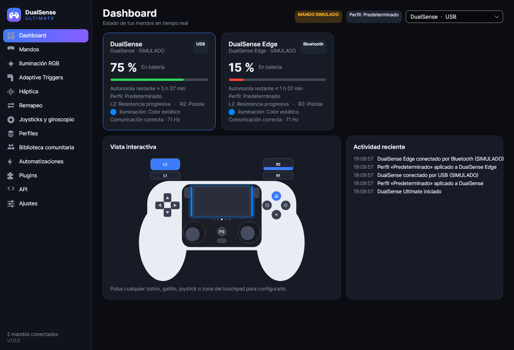

# DualSense Ultimate

Aplicación de escritorio para **Windows 10 y Windows 11** que reúne en un solo programa lo que hoy
obliga a combinar Steam Input, DS4Windows, DSX y pydualsense: iluminación, gatillos adaptativos,
háptica, remapeo, macros, giroscopio, emulación de mandos, perfiles por juego, automatizaciones,
plugins y una API local. Compatible con **DualSense**, **DualSense Edge** y **DualShock 4**, por USB y
Bluetooth, con varios mandos a la vez.

[](https://github.com/diego233l/Dualsense-Ultimate/actions/workflows/build.yml)
[](https://github.com/diego233l/Dualsense-Ultimate/releases)



> **Validación:** las 137 pruebas automatizadas pasan en Windows y Linux con mandos simulados que
> hablan el protocolo real. El usuario informa que todas las funciones implementadas también se
> validaron correctamente en hardware real el 10 de noviembre de 2026. La opción «Desactivar efectos de luz del juego» se añadió después y aún no se ha probado en hardware. `FEATURES.md` detalla las
> funciones disponibles y sus limitaciones conocidas.

## Instalación

La versión estable 1.0.0 está disponible en [Releases](https://github.com/diego233l/Dualsense-Ultimate/releases).

1. Descarga `DualSenseUltimate-Setup-x.y.z.exe` de [Releases](https://github.com/diego233l/Dualsense-Ultimate/releases)
   (o el artefacto `DualSenseUltimate-Setup` de la última ejecución de GitHub Actions).
2. Ejecútalo. La instalación es por usuario y **no necesita permisos de administrador**.
3. Opcional, solo si quieres emular un mando Xbox o DualShock 4: marca **ViGEmBus** y **HidHide** en
   el instalador (se descargan de sus repositorios oficiales y sí piden permisos de administrador).
4. Conecta el mando por USB o emparéjalo por Bluetooth en Windows. Aparecerá solo en el Dashboard.

Versión portable: descarga y descomprime `DualSenseUltimate-Portable-x.y.z.zip`; después ejecuta
`DualSenseUltimate.exe`. No requiere instalar .NET.

Desinstalación: desde «Aplicaciones instaladas». El desinstalador vuelve a mostrar cualquier mando
ocultado, quita el inicio automático y pregunta si quieres conservar tus perfiles.

## Uso rápido

| Sección | Para qué |
|---|---|
| Dashboard | Mandos, batería, perfil activo y dibujo interactivo del mando |
| Iluminación RGB | Barra de luz (9 efectos + editor), LEDs de jugador, LED del micrófono |
| Adaptive Triggers | Editor visual de L2/R2 con todos los efectos del protocolo |
| Háptica | Vibración, patrones, reactivo al sonido, audio háptico por USB |
| Remapeo | Botones, macros, combinaciones, touchpad, emulación y modo híbrido |
| Joysticks y giroscopio | Zonas muertas, curvas, calibración, giroscopio como ratón o stick |
| Perfiles | Globales, por mando y automáticos por ejecutable |
| Biblioteca comunitaria | Descarga perfiles y efectos compartidos |
| Automatizaciones | Reglas «si… entonces…» |
| Plugins / API | Integraciones (Home Assistant, scripts, juegos) |

Manual completo: [docs/USER_MANUAL.md](docs/USER_MANUAL.md).

## Compilar desde el código

Requisitos: .NET SDK 10. Para el instalador, Inno Setup 6 (solo Windows).

```powershell
dotnet build
dotnet test
dotnet run --project src/DualSenseUltimate.App      # ejecutar
pwsh scripts/publish.ps1 -Version 1.0.0             # build autocontenida + instalador
dotnet run --project tools/HardwareCheck            # validación guiada con un mando real
```

## Documentación

- [ARCHITECTURE.md](ARCHITECTURE.md) · [FEATURES.md](FEATURES.md) · [TESTING.md](TESTING.md) ·
  [KNOWN_ISSUES.md](KNOWN_ISSUES.md) · [ROADMAP.md](ROADMAP.md) · [CHANGELOG.md](CHANGELOG.md) ·
  [CONTRIBUTING.md](CONTRIBUTING.md)
- [docs/RESEARCH.md](docs/RESEARCH.md): investigación de protocolos y viabilidad
- [docs/API.md](docs/API.md) · [docs/PLUGINS.md](docs/PLUGINS.md) · [docs/PROFILE_FORMAT.md](docs/PROFILE_FORMAT.md)

## Licencia

MIT. Componentes de terceros en [THIRD_PARTY_NOTICES.md](THIRD_PARTY_NOTICES.md). Proyecto
independiente, sin relación con Sony Interactive Entertainment.
